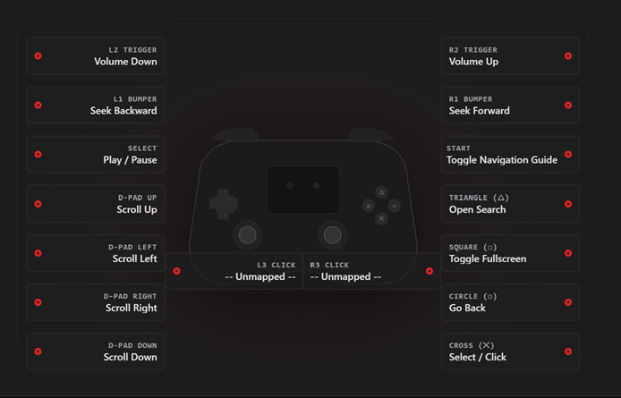
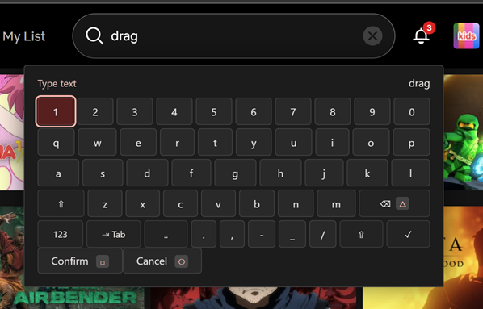

<p align="center">
  
</p>

<h1 align="center">Remapad</h1>

<p align="center">
  A browser extension that lets you control web pages with a gamepad.
</p>

<p align="center">
  
  
  
  
  
  
</p>

---

Remapad is a cross-browser extension (Manifest V3) for USB and Bluetooth
controllers. You set up button mappings per site, navigate with a virtual
cursor, scroll, type with an on-screen keyboard, and interact with page
elements directly. It works on Firefox 140+ and Chromium-based browsers
(Chrome 111+, Edge 111+). No bundler, no dependencies, just plain HTML/CSS/JS.

## Install

| Browser | Link |
| --- | --- |
| Firefox | [Firefox Add-ons](https://addons.mozilla.org/en-US/firefox/addon/remapad/) |
| Chrome | [Chrome Web Store](https://chromewebstore.google.com/detail/remapad-%E2%80%94-gamepad-browser/nbjngbeilcghlhgcofapgclljddnlaol) |
| Edge | [Microsoft Edge Add-ons](https://microsoftedge.microsoft.com/addons/detail/remapad-%E2%80%94-gamepad-browser/ihhkjgcalmhooihpdcdifapgladiblgj) |

Source code lives on [GitLab](https://gitlab.com/Shin-Aska/remapad) (primary)
with a [GitHub mirror](https://github.com/Shin-Aska/remapad).

## Screenshots

### Mapping editor

Pick a button on the controller diagram and bind it to playback controls,
navigation, keyboard shortcuts, or direct DOM actions.



### On-screen keyboard



## Features

- Per-site profiles (Netflix, Prime Video, etc.) with a shared fallback
- Visual mapping editor that shows your actual controller layout
- Stick assignment: virtual cursor, scrolling, directional nav, or disabled
- DOM actions: click, focus, scroll-to, fill, toggle, or control elements
  directly instead of relying on keyboard shortcuts
- Keyboard capture for binding physical keys and combos like `Ctrl+Alt+S`
- On-screen keyboard for typing on pages that expect physical input
- Navigation Mode for controller browsing across websites, with global and per-site switches
- Browse with Remapad: URLs, default browser search, visible open tabs, and optional bookmark/history suggestions
- Navigation HUD that shows active bindings without leaving the page
- Auto-detected controller glyphs (PlayStation, Xbox, Nintendo) with manual override
- Page-level gamepad isolation to prevent sites from double-handling input

## Browse with Remapad

Open **Browse with Remapad** from the popup or Navigation Guide. Use the side
keyboard with D-pad and A, then choose **Done** to keep the query and focus
suggestions. LT and RT switch browser tabs. B cancels keyboard edits or returns
to the original tab when the keyboard is closed. **Close Browse** dismisses the
launcher. You can also use the **Close Browser Tab** combination saved for the
page that opened it. **Edit current URL** copies the original address when site
access makes it visible.
Addresses, bookmarks, and history entries also switch to an
existing permission-visible tab with the same canonical URL, including tabs
opened after suggestions appeared; otherwise they open a new tab. Searches open
a new tab. Browse closes once you reach the destination. Suggestions offer
HTTP and HTTPS destinations.

For a controller alternative to opening a new tab, record **Browse with
Remapad** under a site's **Profile Shortcuts** in Navigation Mode. Save the
mapping, then hold the combination for the duration shown in the editor.

Open-tab suggestions use metadata visible under existing site grants. Bookmarks,
recent history, and default browser search each ask for separate optional access
from **Suggestion sources**. They can be removed there or in browser settings.
Suggestions and history queries stay in memory and are not saved or exported.
Navigation Mode requests broad website access when enabled; global and per-site
switches continue to control whether Remapad runs. See [PRIVACY.md](PRIVACY.md).

## Browser Navigation Mode

When assigning **Next Browser Tab** or **Previous Browser Tab** to a site, allow
all-sites access in the setup dialog and select **Save and Turn On Navigation
Mode**. This saves the binding and pending Options changes, turns on the mode,
and opens its mappings for the selected site. Choose **Save Site Binding Only**
to save just that assignment, or **Cancel** to discard it.

Users who already had **Next Browser Tab** assigned when the update arrived see
**Move tab switching to Navigation Mode** once, when they visit a website where
Remapad is active or open Settings. **Migrate to Navigation Mode** copies all
saved website mappings and Site Mapping Defaults into a separate set. Choose
**Keep Current Mappings** to dismiss the offer.

In **Miscellaneous Options**, you can also choose **Allow website access**,
**Turn on Navigation Mode**, and **Save Changes**. The mode uses independent
Navigation mappings. To pause it and keep your saved profiles, choose **Turn mode
off** and save. The popup’s global and per-site switches also pause controls.
After revoking access in browser settings, grant access again, turn on the mode,
and save to resume cross-site control.

With Navigation Mode on, select **Browser Navigation Mode mappings** in the
mapping environment to edit a site’s profiles. A button mapped to **Swap to Next
Profile** or **Swap to Previous Profile** switches on a fresh press. The default
held shortcuts use Start + D-pad Right or Left to switch profiles, Select + Start
to open Browse with Remapad, and Cross/A + Select to close the active tab. The
editor shows the equivalent buttons for the controller layout. Use **Profile
Shortcuts** to record, clear, or restore a combination for that site. Hold all
buttons for the duration shown and release them before using the shortcut again.

Select **Remapad Settings** in the mapping editor to set up profiles and shortcuts
for the Settings tab. Its default Navigation Mode mapping uses LT and RT to
switch browser tabs and LB and RB to switch Settings sections.

## Getting started (dev)

No `npm install`, no build tools. Just clone and go.

### What you need

- Git
- Firefox 140+, Chrome 111+, or Edge 111+
- Bash + Python 3, or PowerShell
- A USB/Bluetooth gamepad for testing input

### Clone and build

```bash
git clone https://gitlab.com/ShinAska/remapad.git
cd remapad
```

Build all three browser variants:

```bash
bash scripts/build.sh        # or: .\scripts\build.ps1 on PowerShell
```

Build just one:

```bash
bash scripts/build.sh chrome
bash scripts/build.sh firefox
bash scripts/build.sh edge
```

Both build scripts accept `all` (default), `chrome`, `edge`, or `firefox`.
They validate both canonical manifests and produce:

| Target | Unpacked extension | Store package |
| --- | --- | --- |
| Chrome | `dist/chrome/` | `dist/remapad-chrome-<version>.zip` |
| Edge | `dist/edge/` | `dist/remapad-edge-<version>.zip` |
| Firefox | `dist/firefox/` | `dist/remapad-firefox-<version>.zip` |

### Loading the extension

**Chrome:** `chrome://extensions/` → Developer mode → Load unpacked → `dist/chrome/`

**Edge:** `edge://extensions/` → Developer mode → Load unpacked → `dist/edge/`

Edge is a separate install with its own extension storage. Settings don't
transfer from Chrome. The generated Edge manifest inherits Chrome's
`minimum_chrome_version` of `111`.

**Firefox:** `about:debugging#/runtime/this-firefox` → Load Temporary Add-on →
`dist/firefox/manifest.json`

After rebuilding, reload the extension from the browser's extension page.

For build pipeline diagrams, runtime flow, repo layout, and cross-browser
details, see [docs/architecture.md](docs/architecture.md).

## Dev workflow

1. Make a change.
2. Build for the browser you're testing.
3. Reload the unpacked extension.
4. Check the options page and controller input.
5. Test on a real site.
6. Run the full three-browser build before submitting.

Run the focused Navigation Mode regression tests with an existing Node.js
installation:

```bash
node tests/navigation-mode.test.cjs
```

These narrow automated checks do not replace browser and physical-controller
testing. Include your browser version, OS, controller model, connection type,
and tested sites in any compatibility report.

See [CONTRIBUTING.md](CONTRIBUTING.md) for the full checklist.
For store releases, see the [release checklist](docs/release-checklist.md) and
[store listing notes](docs/store-listing.md).

## Privacy

Remapad stores config in local extension storage. Netflix and Prime Video are
built-in profiles. Standard mode accesses additional sites when you add and
authorize them; opt-in Browser Navigation Mode requests all-sites access for
controller navigation. Optional bookmarks/history suggestions stay local, and
chosen searches use the browser’s default provider. No analytics, telemetry, or
remote code. See [PRIVACY.md](PRIVACY.md).

## License

[GPL-3.0-only](LICENSE)
